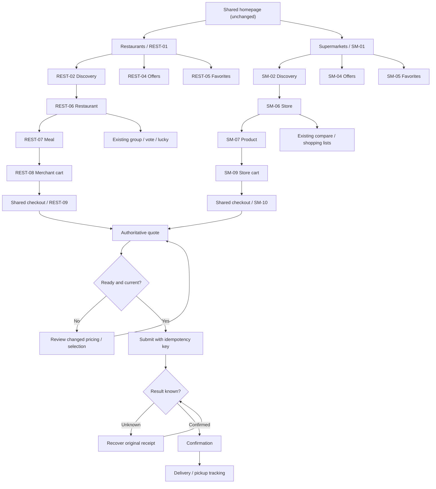
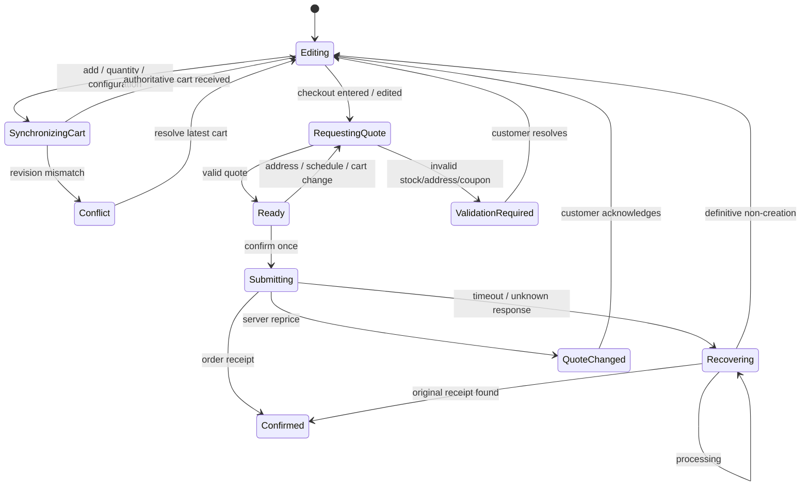
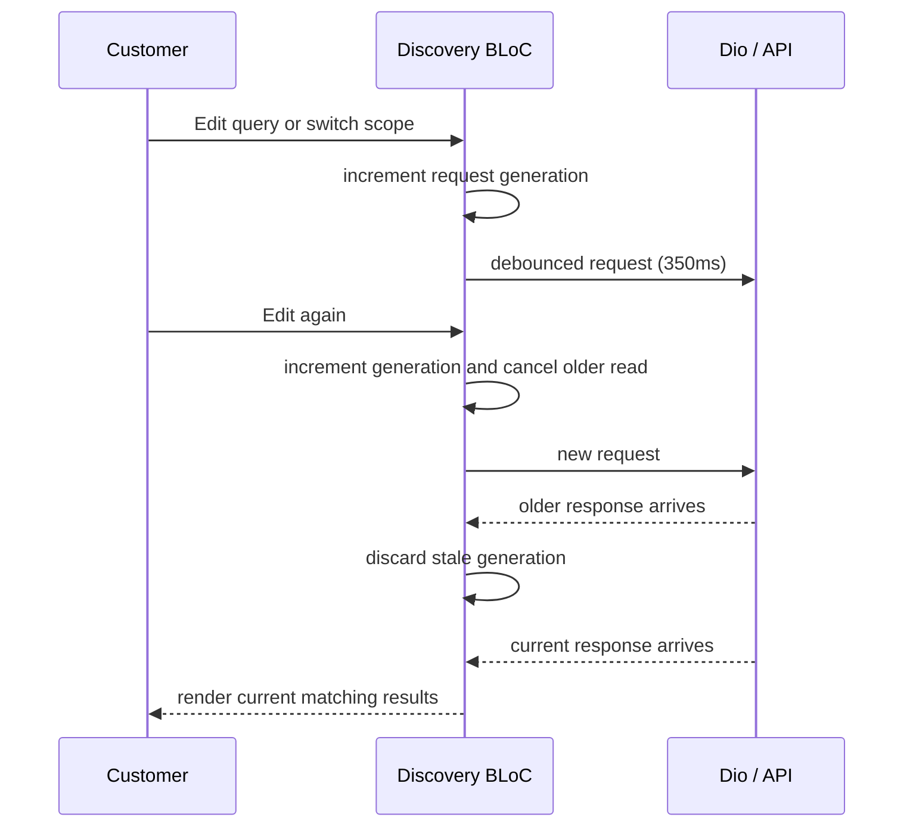

# Phase 1 — Navigation and interaction state diagrams

These are proposed design diagrams, not evidence that backend routes already implement the contracts.

## Commerce navigation (both sections)

## Cart and quote state machine

## Search generation guard

## Tracking refresh and timeout behavior

Foreground active orders use 15-second polling fallback, notification-triggered refresh and app-resume refresh. Deduplicate overlapping requests. No polling in background or terminal states. Pickup orders omit courier maps. On connectivity loss, show last known status with freshness timestamp; never overwrite it with an empty status. If order submission timed out, recover by original idempotency key rather than issuing a fresh order.

## Component callback boundaries
- Commerce header: `onBack`, `onLocationSelect`, `onCartOpen`.
- Search: `onTextChanged`, `onScopeChange`, `onFilterApply`, `onFilterReset`, `onLoadNext`.
- Merchant/product: `onOpen`, `onModifierChanged`, `onQuantityChanged`, `onAddToCart`.
- Cart/checkout: `onCartReconcile`, `onEditAddress`, `onEditSchedule`, `onApplyCoupon`, `onRequestQuote`, `onConfirm`, `onRecoverSubmission`.
- Order: `onRefresh`, `onCancel` / `onReschedule` only when server policy allows.
